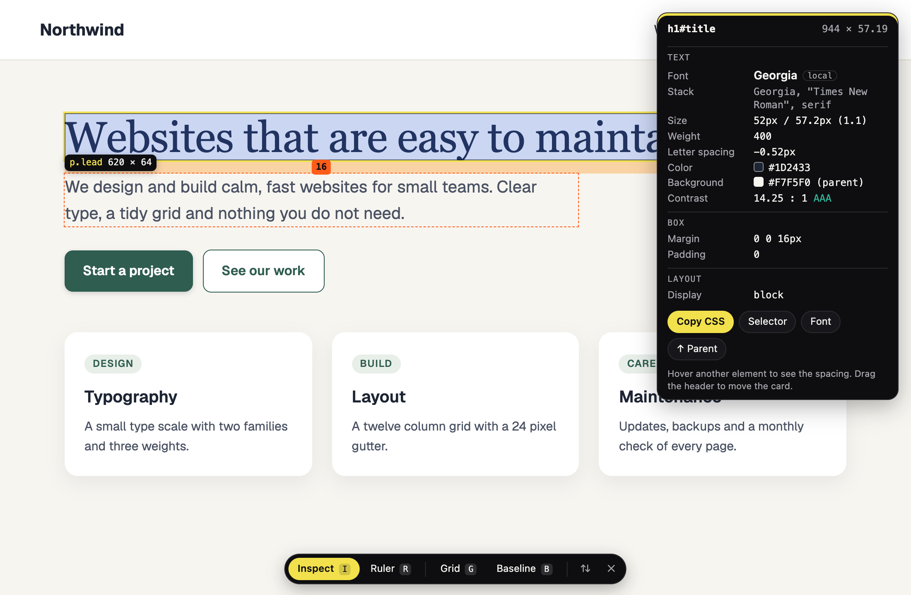
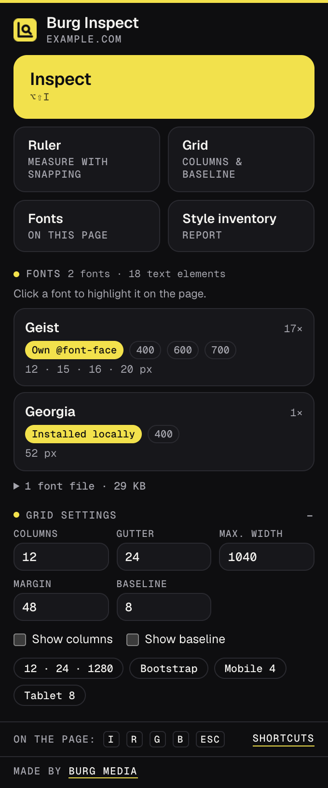
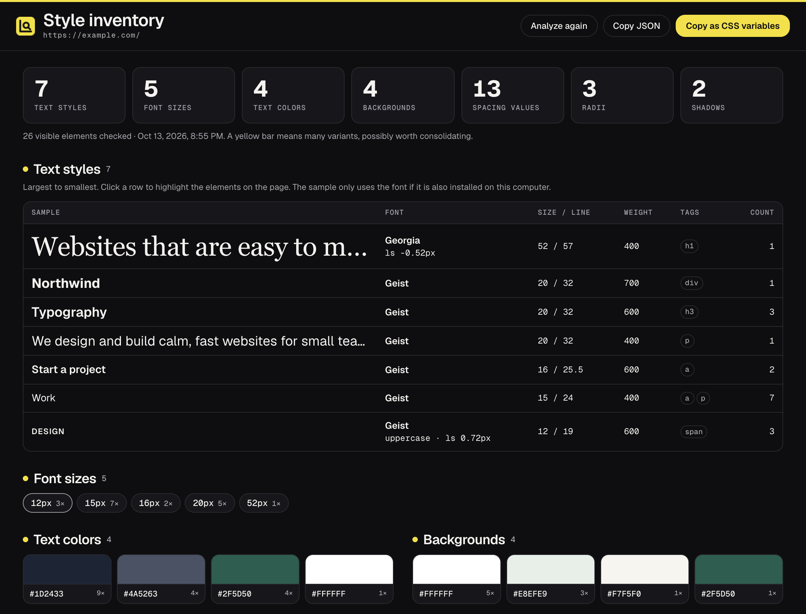

# Burg Inspect

A Chrome extension to see the fonts, sizes, colors, spacing and CSS of any element on a web page by hovering over it, with a ruler, a column and baseline grid, a font overview and a style inventory of the whole page.





## Features

- **Inspect.** Hover over an element to see a card with its tag, id, classes and size; the font that is actually rendered (web font, installed locally or system font, not just the first name in the CSS) and the fonts in the stack that are not available; size, line height, weight, letter spacing and text transform; text and background color in HEX; the WCAG contrast ratio with AA or AAA; margin, padding, border, radius and shadow; display, flex or grid details, gap, position and opacity.
- **Box model overlay.** Margin in orange, padding in green and content in blue, drawn over the element.
- **Measure spacing.** Click an element to pin it, then hover another element to see the distances between them in pixels.
- **Navigate.** Arrow keys move to the parent, the first child or the siblings of the element.
- **Copy CSS.** Press C (or use the button on the pinned card) to copy the element's CSS: only the properties that differ from a bare element with the same tag, colors in HEX. S copies a unique CSS selector, and the **Font** button copies the `font-family`.
- **Ruler.** Drag a rectangle to measure width and height. The start and end points snap to the edges and padding of nearby elements within 6 pixels; hold Alt to measure freely.
- **Grid.** Lay a column grid (columns, gutter, maximum width, margin) and a baseline grid over the page to check alignment. Change the settings in the popup and see them on the page right away, or pick a preset (12 columns, Bootstrap, mobile, tablet).
- **Toolbar and keys on the page.** I inspect, R ruler, G column grid, B baseline grid, Esc first clears the selection or measurement and then stops. Right-click works like Esc. With inspect and ruler both off, the page works normally and only the grid stays visible. The toolbar can move to the top of the page.
- **Keyboard shortcut.** Alt+Shift+I (Option+Shift+I on macOS) turns inspecting on and off. You can change it under `chrome://extensions/shortcuts`.
- **Fonts on this page.** Every rendered font with its origin (for example Google Fonts, Adobe Fonts, Bunny Fonts, the site's own `@font-face`, embedded, installed locally or system), weights, sizes and how many elements use it. Also web fonts that did not load and what the page fell back to, and the font files the page loaded with their size. Click a font to highlight its elements on the page.
- **Style inventory.** A report in a new tab with all text styles (font, size, line height, weight), font sizes, text and background colors, spacing values (margin, padding and gap, with a check against a 4 pixel grid), border radii and shadows of the visible elements, each with a count. A yellow mark shows where a page uses many variants. Click a value to highlight the elements in the original tab, and copy everything as CSS variables (`:root { … }`) or JSON.
- **English and Dutch** interface, following your browser language.



Limits: Burg Inspect works in the main frame of the page, so an iframe is measured as one block. Hovering also reaches into open shadow roots. Chrome does not allow any extension on `chrome://` pages or in the Chrome Web Store; Burg Inspect shows a message there.

## Install from source (Developer mode)

The easiest way to install Burg Inspect is the Chrome Web Store version, linked from the [Burg Inspect page](https://burgmedia.eu/shop/burg-inspect). That version updates automatically. If you prefer to run the code from this repository, it takes a minute:

1. **Download the code.** Click the green **Code** button on this page and choose **Download ZIP**, or download the zip from [Releases](../../releases). Unzip it.
2. **Open the extensions page.** Type `chrome://extensions` in the address bar and press Enter.
3. **Turn on Developer mode.** Use the **Developer mode** switch in the top right corner.
4. **Load the extension.** Click **Load unpacked** and choose the unzipped folder (the folder that contains `manifest.json`).
5. **Pin it.** Click the puzzle piece icon in the toolbar and pin Burg Inspect, so the icon is always visible.

Good to know:

- **Other browsers.** This also works in other Chromium based browsers, such as Microsoft Edge (`edge://extensions`), Brave (`brave://extensions`) and Opera (`opera://extensions`). The steps are the same; the Developer mode switch may be in a different place on the page. Burg Inspect needs version 116 or newer.
- **No automatic updates.** An extension loaded this way does not update itself. To update, download the new version, replace the folder and click the **Reload** icon on the Burg Inspect card in `chrome://extensions`.
- **Developer mode notice.** Chrome may remind you that extensions in developer mode are running. That is normal for extensions you load yourself.

## Check it yourself with your AI agent

The code is small, has no build step and is not minified, so you don't have to take our word for anything. Point your own AI agent (Claude Code, Cursor, Copilot, ChatGPT) at this folder and let it check.

```text
Audit this Chrome extension for security and privacy before I install it.
1. List every permission in manifest.json and whether the code actually needs it.
2. Find every network request (fetch, XMLHttpRequest, WebSocket, sendBeacon, image or
   script URLs, remote code) and tell me where data goes.
3. Check for remote code execution: eval, new Function, remotely loaded scripts.
4. Check what is stored (chrome.storage, IndexedDB, cookies) and whether anything
   leaves my browser.
5. Check content scripts: which sites they run on and what they read from pages.
6. Give a verdict: safe to install or not, with file and line references.
```

The fastest manual check, from inside the folder:

```sh
grep -rn "fetch\|XMLHttpRequest\|http" .
```

Besides this README and NOTICE.md you will find the burgmedia.eu links described below, two XML namespace URLs (`http://www.w3.org/…`) in `images/icon.svg` and `lib/style.js`, and the license URLs in `fonts/LICENSE-Geist-OFL.txt`. There is no `fetch()` or `XMLHttpRequest` in the code.

## Privacy and security

- **No account, no analytics, no tracking, no ads.**
- **No remote code.** All JavaScript is in this repository. There are no CDNs or external scripts, and the extension pages only allow scripts from the extension itself (`script-src 'self'` in `manifest.json`). The fonts (Geist and Geist Mono) are included in `fonts/`.
- **No requests to servers.** The extension does not send data anywhere and does not download anything. The font file sizes come from the browser's own record of what the page already loaded (`performance.getEntriesByType('resource')`); nothing is fetched again.
- **Page access only when you ask.** Burg Inspect looks at a page only after you click the toolbar icon and choose an action, or press the shortcut, and only in that tab. There are no content scripts that run on every site. The overlay runs in a closed shadow root, so the page's scripts and styles cannot read or change it.
- **What it reads from the page.** The computed styles and positions of elements, short text samples (up to 70 characters per text style, for the report), the page's URL and title, its readable `@font-face` rules and font links, and the list of font files the page loaded. This is used only to show you the results.
- **Stored locally.** In `chrome.storage.local` on your device: only your grid settings (columns, gutter, maximum width, margin, baseline and whether they are shown). The style inventory is kept in `chrome.storage.session` (in memory, under the tab's number) so the report tab can show it; it includes the page's URL, title and the text samples, and Chrome clears it when you close the browser. Nothing is synced. Removing the extension removes everything.
- **Clipboard.** Burg Inspect writes the CSS, selector, `font-family`, color, shadow, CSS variables or JSON you copy to the clipboard. It never reads the clipboard.

What does go out, and when:

- **After installing**, a welcome page opens once on burgmedia.eu (`https://burgmedia.eu/extensies/burg-inspect/welkom/`). **After removing** the extension, Chrome opens a short page there (`…/verwijderd/`). Both URLs carry only fixed labels (`utm_source=burg-inspect&utm_medium=extension&utm_campaign=install` or `uninstall`). No settings, measurements, identifiers or browsing data are added. It is a normal page visit, so burgmedia.eu sees what any website sees, such as your IP address and browser; the privacy policy of burgmedia.eu applies there.
- **"Made by Burg Media"** at the bottom of the popup is a link with the same kind of labels (`utm_campaign=popup`), and the report page has a plain link to burgmedia.eu in its footer. They open only when you click them.

Found a security problem? See [SECURITY.md](SECURITY.md).

## Why is this free?

Burg Media is a small web studio in the Netherlands. We build these tools for our own work and give them away: no ads, no premium tier, no data collection. If they are useful to you, that is the best introduction to what we do. We build websites, web apps and custom software: [burgmedia.eu](https://burgmedia.eu)

## Permissions explained

| Permission | Why Burg Inspect needs it |
|---|---|
| `activeTab` | Gives temporary access to the current tab only, and only after you click the toolbar icon or press the shortcut. Needed to show the overlay there, list its fonts and build the style inventory. The report can highlight elements in that tab for as long as this access lasts. No access to other tabs or sites. |
| `scripting` | Injects the bundled overlay, the font scan, the style inventory and the temporary highlight into that tab, and sets a crosshair cursor while you inspect or measure. Only after your click or shortcut, and only code from this repository. |
| `storage` | Saves your grid settings locally on your device (`chrome.storage.local`), and keeps the style inventory in memory for the report tab (`chrome.storage.session`). |
| `clipboardWrite` | Copies CSS, selectors, fonts, colors, shadows, CSS variables and JSON to the clipboard, also while you work directly on a web page. The clipboard is never read. |

There are no `host_permissions` and no content scripts in `manifest.json`: Burg Inspect cannot read or change any website on its own. The `commands` entry in the manifest is the keyboard shortcut, not a permission.

## Alternatives

Looking for an alternative to WhatFont, Page Ruler, CSS Peeper or VisBug? Burg Inspect covers that everyday work in one extension: seeing which font a page really renders, measuring sizes and the spacing between elements, copying clean CSS, checking a layout against a grid and getting an overview of every text style, color and spacing value a site uses. It needs no account, asks for no access to your sites until you click, and the source is right here for you to read.

## License

[MIT](LICENSE), Copyright (c) 2026 Burg Media. Third-party components and their licenses are listed in [NOTICE.md](NOTICE.md).

Made by [Burg Media](https://burgmedia.eu).
